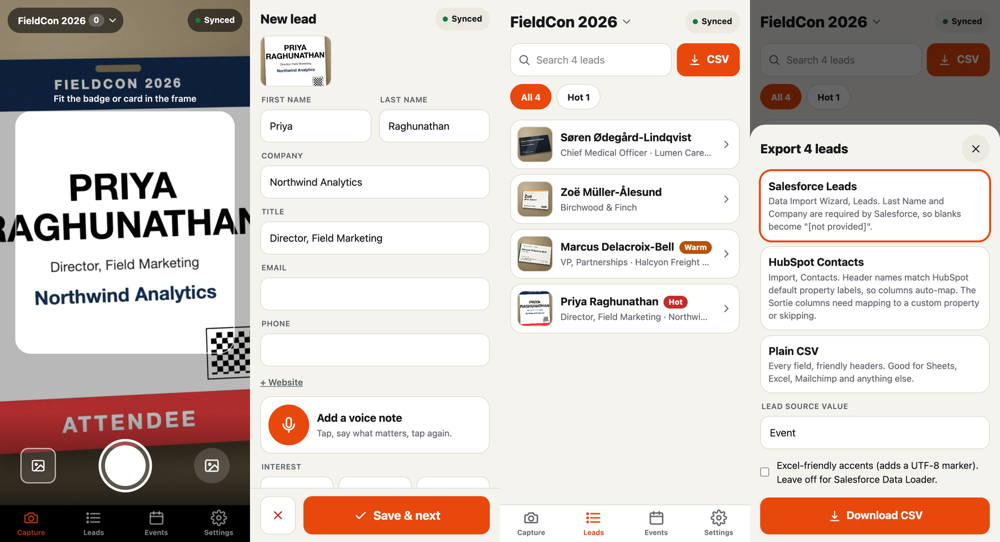
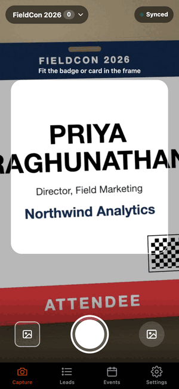

# Sortie

**Lead capture for event marketers. Snap a badge or business card, say a quick voice note, and walk away with a CSV that imports cleanly into Salesforce or HubSpot.**

An installable web app (PWA) built for one thumb on an iPhone at a loud booth. No accounts, no database to run, works with no signal.





*Screenshots and the GIF are generated by driving the real app in headless Chrome at iPhone size (`npm run screenshots`), with a fake camera and made-up people.*

## The 60-second flow

1. **Open** the app. It goes straight to the camera.
2. **Snap** the badge or card. It is saved on the phone instantly.
3. **Fields fill in** (first name, last name, company, title, email, phone) a second or two later.
4. **Voice note** (optional): tap the mic, say what matters, tap again. It is transcribed in the background.
5. Tap **Hot / Warm / Cold**, then **Save & next**. You are back at the camera.

Everything you can do on the capture sheet is also available later from the **Leads** tab: edit, search, filter, merge duplicates, export.

## Features

- **Reads badges and cards** with a multimodal model through [OpenRouter](https://openrouter.ai). Handles accents (Zoë, Søren), ALL-CAPS badges, two-line titles, tilted and dim photos. See [verification](#verification).
- **Offline first.** Captures and voice notes are saved in IndexedDB before anything touches the network. A persisted queue reads them whenever there is signal, with backoff and automatic recovery. The pill at the top always says what is going on: *Offline · 3 waiting*, *No connection · 1 waiting*, *Reading 2…*, *2 failed · retry*, or *Synced*.
- **Never overwrites your typing.** If you correct a field before the AI answers, your edit wins.
- **Per-event lists.** Each show gets its own list, counts and CSV.
- **Duplicates.** Flagged live while you capture ("Looks like Priya Raghunathan you already captured") and in a review sheet. Matches on email, phone, or name plus company, ignoring accents and "Inc."; merge keeps the oldest and fills blanks.
- **CSV for Salesforce, HubSpot, or anything else.** See [column mapping](#csv-and-column-mapping). Shares through the iPhone share sheet (Files, Mail, AirDrop) or downloads.
- **Voice notes** transcribed by Whisper on the server, or by the browser's own speech recognition (experimental).
- **Cost log.** Every paid call records its real OpenRouter charge; Settings shows total and per-capture cost and exports a log.
- **Bring your own key.** No server key needed: paste an OpenRouter key in Settings and it is sent per request, never stored on the server.

## Quick start

Requires Node 20.9+ and an [OpenRouter key](https://openrouter.ai/keys).

```bash
git clone https://github.com/treynortetik-creator/sortie.git
cd sortie
npm install
cp .env.example .env.local      # then set OPENROUTER_API_KEY
npm run dev                     # http://localhost:3000
```

Camera, microphone and the service worker need HTTPS on a real phone (localhost is exempt on your laptop). To try it on your phone before deploying, use a tunnel such as `cloudflared tunnel --url http://localhost:3000`.

Production check: `npm run build && npm start`.

### Install on iPhone

Open the deployed URL in **Safari**, tap Share, then **Add to Home Screen**. Open it once online so it can cache itself; after that it launches and captures with no signal.

## Configuration

All settings are server-side environment variables. Nothing in `.env` is ever sent to the browser.

| Variable | Default | What it does |
|---|---|---|
| `OPENROUTER_API_KEY` | none | Server key. Optional if every user brings their own. |
| `SORTIE_ACCESS_CODE` | none | If set, requests must carry this code (users enter it in Settings). **Set this on any public URL**, or anyone who finds it can spend your credits. |
| `SORTIE_DAILY_BUDGET_USD` | `5` | Stops server-key calls for the day once this much is spent (per server instance, resets at 00:00 UTC). |
| `SORTIE_EXTRACT_MODEL` | `google/gemini-3.1-flash-lite` | Model that reads photos. Must accept images. |
| `SORTIE_STT_MODEL` | `openai/whisper-large-v3-turbo` | Model that transcribes voice notes. |
| `SORTIE_RATE_LIMIT_PER_MIN` | `60` | Requests per IP per minute. |
| `SORTIE_ALLOW_MODEL_OVERRIDE` | off | Let clients pick any model on your key. Off by default; users with their own key can always pick. |
| `SORTIE_ALLOW_DATA_COLLECTION` | off | Off means photo requests ask OpenRouter to use only providers that do not retain or train on prompts. |

## Models and cost

Picked on **2026-10-02** by querying OpenRouter's `/models` API and running the synthetic test set through eight vision models:

| Model | Result on 30 fields | Cost per photo | Notes |
|---|---|---|---|
| **`google/gemini-3.1-flash-lite`** (default) | 30/30 | **$0.00055** | Fast (about 1.7 s). Gemini Flash class as requested. |
| `google/gemini-3.5-flash-lite` | 30/30 | $0.00073 | Pricier than 3.1 for no gain here. |
| `google/gemini-3-flash-preview` | 30/30 | $0.00105 | Preview model. |
| `google/gemma-4-26b-a4b-it` | 30/30 | $0.00009 | **6x cheaper**, worth trying at volume. |
| `qwen/qwen3.7-flash` | 29/30 | $0.00008 | Invented a title ("Exhibitor") from a badge ribbon; slow (5 s). |
| `openai/gpt-6-luna` | 30/30 | $0.00033 | Slower (4.9 s). |
| `mistralai/mistral-small-2603` | 30/30 | $0.00039 | |
| `qwen/qwen3.8-flash` | not scored | | Upstream rate-limited during the run. |

Speech: **`openai/whisper-large-v3-turbo`** through OpenRouter's `/audio/transcriptions`, about **$0.00003 to $0.0001** for a 10-second note. It accepted both iPhone (m4a) and Chrome (webm) recordings in testing.

**Per lead:** about **$0.0006** for the photo, plus about $0.00005 if there is a voice note. A 1,000-lead event costs roughly **$0.60**. Costs come from OpenRouter's own `usage.cost` on each response, never estimated; the server logs one `sortie.cost` JSON line per call and the app stores it on the lead.

The comparison used 5 clean synthetic images and was a quick selection test, not a benchmark. Rerun it for your own cards before committing at scale.

## CSV and column mapping

Pick the format in the export sheet. Files are UTF-8, CRLF, RFC 4180 quoting. Cells that start with `=`, `@`, tab or a non-phone `+`/`-` get a leading apostrophe so a hostile badge cannot run a formula when someone opens the file in Excel or Sheets.

### Salesforce Leads (Data Import Wizard)

| CSV column | Comes from | Notes |
|---|---|---|
| First Name | First name | |
| Last Name | Last name | **Required by Salesforce.** Blank becomes `[not provided]`. |
| Company | Company | **Required by Salesforce.** Blank becomes `[not provided]`. |
| Title | Title | |
| Email | Email | |
| Phone | Phone | As printed. |
| Website | Website | |
| Lead Source | Set in the export sheet (default `Event`) | Match your picklist value, e.g. `Trade Show`. |
| Rating | Hot / Warm / Cold tap | Standard Lead `Rating` field. |
| Description | Notes, then `Voice note: …`, then `Captured at <event> on <date>` | Multi-line cell. |

In Salesforce: Setup, Data Import Wizard, Leads, CSV, map the columns (they match by name), and choose whether to run assignment rules.

### HubSpot Contacts (Import)

| CSV column | Comes from | Notes |
|---|---|---|
| First Name | First name | Auto-maps to the default property. |
| Last Name | Last name | Auto-maps. |
| Email | Email | Used for de-duplication by HubSpot. |
| Phone Number | Phone | Auto-maps. |
| Job Title | Title | Auto-maps. |
| Company Name | Company | Auto-maps. |
| Website URL | Website | Auto-maps. |
| Lead Status | Always `New` | |
| Sortie Event | Event name | Not a default property: map to a custom property or skip. |
| Sortie Rating | Hot / Warm / Cold | Same. |
| Sortie Notes | Notes | Same. |
| Sortie Voice Note | Voice-note transcript | Same. |
| Sortie Captured At | Capture time, UTC ISO 8601 | Same. |

### Plain CSV

First Name, Last Name, Title, Company, Email, Phone, Website, Event, Rating, Notes, Voice Note, Captured At.

> **Verify with two rows first.** The header names follow Salesforce's and HubSpot's documented import conventions and are covered by tests, but neither importer has been run against a live account by this project. Import a two-row file into a sandbox or test list before your first real upload. Example outputs from the screenshot tour are in [`docs/samples/`](docs/samples/).

## Deploy

Sortie is a standard Next.js app with two stateless API routes. There is no database.

### Vercel

1. Import the repo at [vercel.com/new](https://vercel.com/new) (framework auto-detected).
2. Add environment variables: `OPENROUTER_API_KEY`, `SORTIE_ACCESS_CODE`, optionally `SORTIE_DAILY_BUDGET_USD`.
3. Deploy. Open the URL on your phone and Add to Home Screen.

Notes: function bodies are limited to about 4.5 MB on Vercel; photos are resized on the phone to a few hundred KB and voice notes are small, so this is fine. Rate limit and budget counters are per serverless instance, a speed bump rather than a hard cap, so also set a **spending limit on the OpenRouter key**.

### Railway

1. New Project, Deploy from GitHub repo. Railway picks up `railway.json` and the `Dockerfile`.
2. Variables: `OPENROUTER_API_KEY`, `SORTIE_ACCESS_CODE`.
3. Generate a domain. The health check is `/api/status`.

### Docker

```bash
docker build -t sortie .
docker run -p 3000:3000 -e OPENROUTER_API_KEY=... -e SORTIE_ACCESS_CODE=... sortie
```

Put it behind HTTPS (the camera, microphone and service worker require it).

## Privacy

- **Your leads stay on the phone.** Contacts, photos and voice notes live in the browser's IndexedDB on that device. There is no Sortie database or account. Clearing Safari website data deletes them, so export before you do.
- **What the server sees.** To read a photo, the phone sends it to your Sortie server, which forwards it to OpenRouter and the model provider and returns the extracted text. The photo is held in memory for that request only: **not written to disk, not stored, not logged.** The same applies to voice recordings. The server logs one line per call with model, tokens, cost and duration, and never keys, images, audio or contact text.
- **Third parties.** Whatever OpenRouter and the model provider do with a request is governed by their policies. Photo requests set `provider.data_collection = "deny"`, which asks OpenRouter to route only to providers that do not retain or train on prompts (turn this off with `SORTIE_ALLOW_DATA_COLLECTION=1`). Transcription requests do not carry that preference. Review your OpenRouter privacy settings.
- **Your key.** With a server key, the key never reaches the browser. With bring-your-own-key, the key sits in that phone's localStorage and is sent over HTTPS per request, then forwarded and not stored. Use a key with a low spending limit.
- **No analytics, no third-party scripts, no cookies.** The Content-Security-Policy only allows the app's own origin; the browser never talks to OpenRouter directly.
- **People's data.** You are collecting personal data about other people. Follow the consent rules of your event and region (GDPR and similar). Sortie is a tool, not legal advice.

## How it works

```
 phone (PWA)                                   your server                OpenRouter
 ┌──────────────────────────────┐              ┌───────────────┐
 │ camera -> JPEG (1600px)      │              │ /api/extract  │ ---> vision model
 │ mic    -> m4a / webm         │  multipart   │ /api/transcribe│ ---> Whisper
 │ IndexedDB: events, leads,    │ -----------> │ auth, limits, │
 │   photos, audio, queue state │ <----------- │ cost log      │
 │ service worker: app shell    │  JSON        └───────────────┘
 └──────────────────────────────┘
```

- `src/lib/queue.ts` is the offline queue: persisted state per lead, exponential backoff (2 s doubling to 2 min, 8 tries), crash recovery, pause on bad key, revive on reconnect.
- `src/lib/extraction.ts` holds the prompt and a tolerant parser (fences, chatter, trailing commas, numbers where strings belong, `N/A`).
- `src/lib/csv.ts` builds the three formats; `src/lib/dedupe.ts` finds and merges duplicates.
- `src/lib/server/` has the OpenRouter client and the access, rate and budget guard.
- `public/sw.js` precaches every route's JS and CSS at install, then serves network-first with a 2.5 s timeout so slow wifi counts as offline.

## Verification

All numbers below were produced by scripts in this repo; the raw output is in [`docs/verification/`](docs/verification/).

- **Tests:** `npm test` runs 102 tests: extraction parsing, CSV formats and injection guard, dedupe and merge, the offline queue against a real IndexedDB implementation, and the API routes (auth, limits, errors) with a mocked upstream.
- **Real extraction:** `npm run verify:real` sends 8 synthetic images (5 clean badges and cards with accents and missing fields, 3 hard: dim and motion-blurred, crowded card with a two-line title, low-resolution and rotated) through the real server and OpenRouter. Result on 2026-10-02: **48 of 48 fields correct** (30/30 clean, 18/18 hard), about 2 s and $0.00056 per photo; both voice-note formats transcribed correctly.
- **End to end:** `npm run screenshots` drives the built app in headless Chrome at iPhone size with a fake camera and microphone and asserts the whole flow: capture, extraction, voice note, duplicate merge, both CSV exports, **offline launch with the server process killed**, an offline capture, and automatic sync on reconnect.

Honest limits: the images are synthetic renders, not photos of real badges under real lanyards and fluorescent light; the test browser is Chrome emulating an iPhone, not Safari on a device; the on-device speech option and the share sheet were not exercised. Expect real-world accuracy to be lower than 100%; that is what the edit screen and the "hard to read" warning are for.

## Develop

```bash
npm run dev          # dev server
npm test             # unit tests
npm run lint && npm run typecheck
npm run fixtures     # regenerate the synthetic test images (needs Chrome + ImageMagick)
npm run verify:real  # real OpenRouter calls against a running server, ~half a cent
npm run screenshots  # regenerate docs/screenshots (needs a built app, a key, ffmpeg)
```

Project layout: `src/app` (pages and API routes), `src/components`, `src/lib` (queue, CSV, dedupe, extraction, db), `src/lib/server`, `scripts`, `test/fixtures`.

## Limitations and ideas

- No direct CRM push yet (CSV only). A Salesforce or HubSpot API connector would be the natural next step.
- Leads are per device. There is no sync between phones or team view; export and merge in your CRM.
- One photo per lead (no back-of-card). Handwritten notes are not read.
- iOS may evict site data for sites unused for a week if the PWA is not installed; install it and export after each show.

## License

MIT, see [LICENSE](LICENSE).
